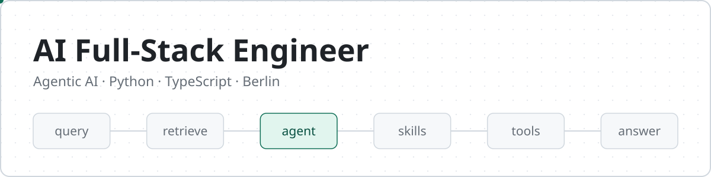

I build AI products end to end, from agent design and retrieval to the APIs and interfaces people use. My work focuses on agentic systems, MCP integrations and LLM tracing.

## Featured projects

**[Production-RAG-MCP](https://github.com/spha-code/Production-RAG-MCP)**  
RAG service with document ingestion, semantic search, a web chat widget and an MCP endpoint.  
FastAPI · ChromaDB · Sentence Transformers · Docker

**[Medical-Bot](https://github.com/spha-code/Medical-Bot)**  
RAG chatbot for medical documents, working with Gemini and OpenAI models.  
Python · Docker · AWS

**[gemini-rag-ragas-eval](https://github.com/spha-code/gemini-rag-ragas-eval)**  
RAG pipeline measured with Ragas evaluation.  
Gemini · LangChain · FAISS · Ragas

**[YouTube Comments Sentiment Analysis](https://github.com/spha-code/YouTube-Comments-Sentiment-Analysis-MLOps)**  
Sentiment pipeline from data collection to tracked experiments.  
Python · MLflow · Docker

**[microgpt](https://github.com/spha-code/microgpt)**  
Small GPT model, following Andrej Karpathy's microgpt.  
Python

## Tech stack

| Area | Tools |
|---|---|
| **Languages** | Python, TypeScript, JavaScript, SQL, Bash |
| **AI and agents** | LangChain, LangSmith, MCP, FastMCP, RAG, Hugging Face |
| **Machine learning** | PyTorch, scikit-learn, pandas, NumPy |
| **MLOps** | Grafana, MLflow, DVC, ZenML |
| **Back end** | FastAPI, Flask, Node.js, npm, Pydantic, asyncio, PostgreSQL, MongoDB |
| **Front end** | React, HTML, CSS, Figma |
| **Infrastructure** | Docker, Kubernetes, Azure, Keycloak, Git, Bitbucket, Linux |
| **3D and media** | Blender, ComfyUI, Cinema 4D, Maya, ZBrush, After Effects |
